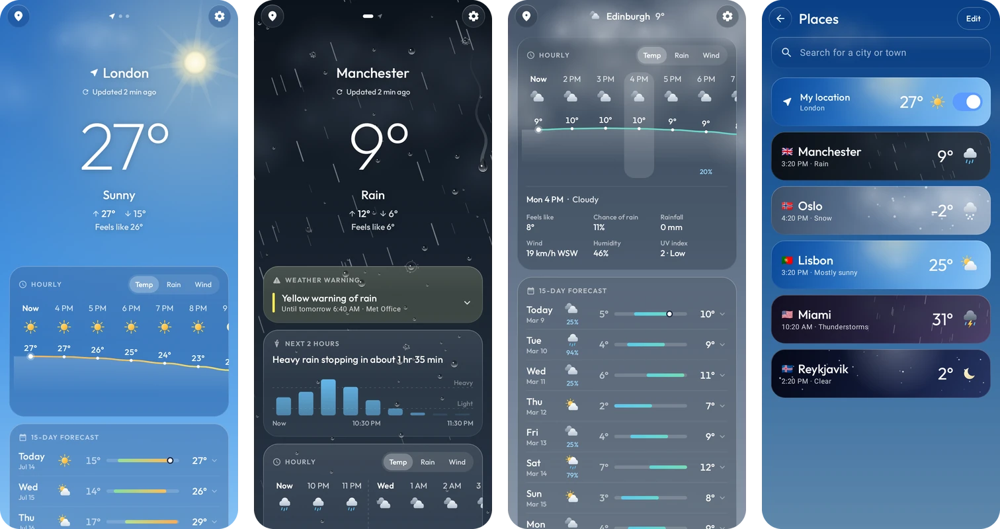

# Nimbus

A fast, modern Android weather app with live home screen widgets, rain alerts and one-tap
in-app updates.



## Highlights

- **Always current.** Shows *when* the data was fetched ("Updated 2 min ago"). It refreshes
  whenever you open the app, every 5 minutes while it stays open, every 15 minutes in the background
  (adjustable), and whenever you pull down. Between fetches the temperature follows the forecast
  timeline, so an hour-old fetch shows the temperature for *now*, not for an hour ago.
- **A living sky.** The background is the weather: its colours follow conditions and time of day,
  with a sun whose rays turn slowly, a moon in its actual phase, stars, drifting clouds, fog,
  lightning, snow, and rain angled by the real wind. Swipe to another place and the sky blends into
  that place's weather under your finger. Cards are frosted glass: clouds and glows carry on behind
  them, falling rain and snow don't.
- **Rain on the glass.** When it rains, drops land on the screen with a splash, sit as beads and
  dry away; heavier ones let go and run down in fits and starts, leaving a wet track. They cross
  the cards too, underneath the text, and there are more of them the harder it rains.
- **Every sky, whenever you like.** **Settings → Skies** is a gallery of all ten: sun, cloud,
  drizzle, rain, thunderstorm, snow, fog, golden hour and a starry night. Swipe from one to the next
  and they blend, so you can watch rain run down the glass on a dry day.
- **Home screen widgets with a refresh button.** Current weather, a forecast (current + hourly +
  daily), and two clocks with the weather. They resize, show the time they were updated (or
  "Offline"), animate their own little skies, and have a ↻ button that fetches fresh data on the
  spot. Each widget can follow a different place.
- **Rain in the next two hours.** 15-minute precipitation data shows "Light rain starting in about
  20 min, lasting about 45 min", with an intensity chart and an optional notification before it starts.
- **Detail on tap.** A 48-hour chart that morphs between temperature, chance of rain and wind (tap
  any hour for everything about it), a two-week forecast with temperature range bars (tap a day for
  its hour-by-hour curve), and tiles for UV, sunrise and sunset, wind, rainfall, feels-like,
  humidity, visibility, pressure, moon phase and cloud cover (most open into a chart of the next
  24 hours), plus air quality (US or European AQI) and pollen.
- **Severe weather warnings**, with notifications: the US National Weather Service, and the Met
  Office and other European services through MeteoAlarm.
- **Met Office forecasts** for the UK and Ireland, if you add your own free Weather DataHub key.
- **Multiple places.** Your location plus any cities you add, each shown under its own sky; swipe
  between them. Long-press the app icon for quick **Places** and **Settings** shortcuts.
- **Your units.** °C/°F, km/h, mph, m/s, knots, mm/in, hPa/inHg/mmHg, km/mi and 12/24-hour time.
  Defaults follow your region.
- **In-app updates.** Nimbus checks this repository's GitHub Releases. When a new build is published
  you get a notification, and one tap downloads, verifies and installs it.
- **Private.** No accounts, no ads, no tracking. Your location is only sent to the weather services
  below to get the forecast.

## Install

1. Open the [latest release](https://github.com/duddmeister/Weather-app/releases/latest) on your
   phone and download `Nimbus-v….apk`.
2. Open the file. If Android asks, allow your browser to install apps.
3. Open Nimbus and tap **Use my location** (or search for a city).
4. Add a widget: long-press your home screen → **Widgets** → **Nimbus**.
5. Optional, for widgets that stay fresh even when the phone is idle: **Settings → Reliable
   background updates** lets Nimbus refresh on schedule instead of being held back by battery saving.

Later updates arrive in the app: you'll get a notification, or see an **Update available** pill.
The first in-app update asks you to allow Nimbus to install apps.

## How releases work

Every push to `main` runs [`.github/workflows/release.yml`](.github/workflows/release.yml). It
builds a signed APK, runs the unit tests and publishes a GitHub Release named `v1.0.<build>` with
the APK attached and the commit messages as release notes. Pull requests run
[`ci.yml`](.github/workflows/ci.yml). It builds, tests and lints, then runs the app on an emulator:
it opens every screen, uploads screenshots, checks that the rain sky leaves drops on the glass, and
updates the installed build to the latest release through the app's own updater.

Releases are signed with the key in [`signing/`](signing/README.md). To use a private key instead,
see that page.

## Building locally

Requires JDK 17+ and the Android SDK (API 36).

```sh
./gradlew assembleDebug          # debug build (installs alongside the release app)
./gradlew testDebugUnitTest      # unit tests
LIVE_API_TEST=1 ./gradlew testDebugUnitTest   # also check the real weather APIs
```

## Data sources

- Forecasts, air quality and place search: [Open-Meteo](https://open-meteo.com/) (CC BY 4.0), with
  air quality from Copernicus CAMS.
- UK and Ireland forecasts, with your own key: [Met Office Weather DataHub](https://datahub.metoffice.gov.uk/).
- Severe weather: the [National Weather Service](https://www.weather.gov/) (US) and
  [MeteoAlarm](https://meteoalarm.org/) (UK and Europe, CC BY 4.0).
- Reverse geocoding fallback (when the phone's own geocoder isn't available):
  [BigDataCloud](https://www.bigdatacloud.com/).

## Credits

- Typeface: [Outfit](https://fonts.google.com/specimen/Outfit), under the SIL Open Font License
  (the licence ships in the app, in `assets/licenses`).
